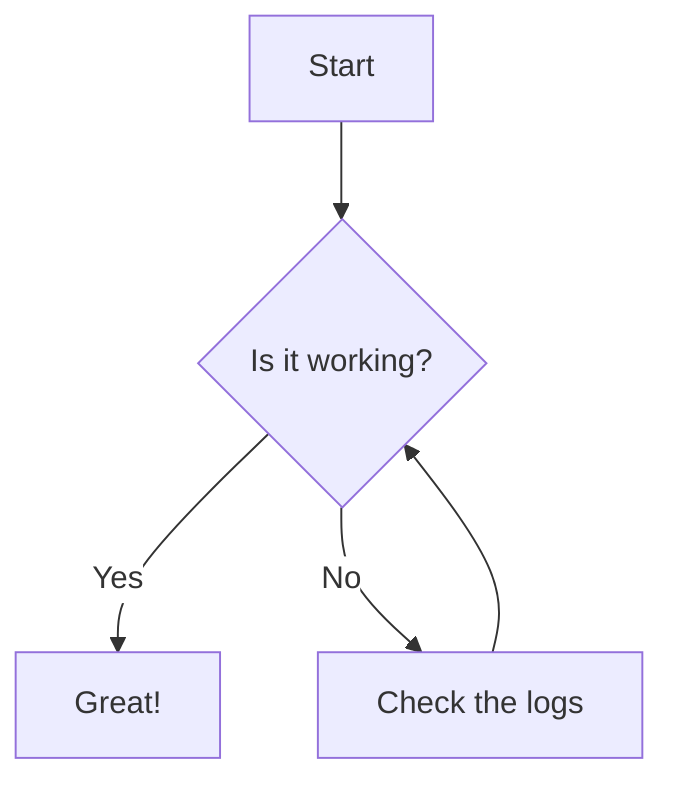

Lorem ipsum dolor sit amet consectetur adipiscing elit. Quisque faucibus ex sapien vitae pellentesque sem placerat. In id cursus mi pretium tellus duis convallis. Tempus leo eu aenean sed diam urna tempor. Pulvinar vivamus fringilla lacus nec metus bibendum egestas. Iaculis massa nisl malesuada lacinia integer nunc posuere. Ut hendrerit semper vel class aptent taciti sociosqu. Ad litora torquent per conubia nostra inceptos himenaeos.

I don't really post on socials. Not my thing. All intrinsic motivated. 

- Bird binder (4x6") scrapbook
    - mpix Giclee (more than enough for a 4x6" print) 
    - Sakura Pigma Micron Fineliner Pens 
    - Glossy
- White board
    - Semi-gloss
    - Magnets
    - Includes a few special bird magnets matching their species. 
    - Highlight the example shown is _all_ in Michigan entirely in 2026 (except for the one cardinal photo)
- [Online bird photo life list](/birds)
    - Explain the script, workflow, wepb, image size, import process from Google photos album download (which is what I keep as the master source). Ensure that is aligns with ebird.
    - Photos on ebird receive minimal editing. 
    - Photos for my own person use receive more aggressive edits (like unblur).


<!-- ## Table of Contents -->



<!-- If an HTML tag has an attribute markdown="block", then the content of the tag is parsed as block level elements. -->
<!-- https://kramdown.gettalong.org/syntax.html#html-blocks -->
<details markdown="block">

<summary>Changelog</summary>

> - 2026-07-13: Changelog Entry #1
> - 2026-07-14: Changelog Entry #2
> - 2026-07-15: Changelog Entry #3

</details>

## Example Post

Lorem ipsum dolor sit amet consectetur adipiscing elit. Quisque faucibus ex sapien vitae pellentesque sem placerat. In id cursus mi pretium tellus duis convallis. Tempus leo eu aenean sed diam urna tempor. Pulvinar vivamus fringilla lacus nec metus bibendum egestas. Iaculis massa nisl malesuada lacinia integer nunc posuere. Ut hendrerit semper vel class aptent taciti sociosqu. Ad litora torquent per conubia nostra inceptos himenaeos.

## Callout

> Example callout

[This is a link](https://example.com)



## Image

*My main dashboard on BirdNET-Go*

## Remove Metadata

```bash
exiftool -all= -overwrite_original -r .

exiftool -gpslatitude .
```

## Line Numbers


exiftool -all= -overwrite_original -r .

exiftool -gpslatitude .


## Table

{: .table-post}
| Syntax      | Description | Test Text     |
| :---        |    :----:   |          ---: |
| Header      | Title       | Here's this   |
| Paragraph   | Text        | And more      |


## Mermaid Diagram



## Details

<!-- If an HTML tag has an attribute markdown="block", then the content of the tag is parsed as block level elements. -->
<!-- https://kramdown.gettalong.org/syntax.html#html-blocks -->
<details markdown="block">

<summary>[YAML] Example Configuration</summary>

```yaml

template:
  - trigger:
      - platform: time_pattern
        # Let's be honest, we don't need to check often. 
        # But 5 minutes should be reactive enough if I need to correct an event date.
        minutes: "/5" 

```
</details>
