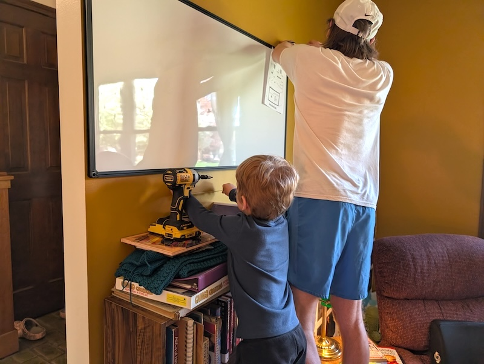
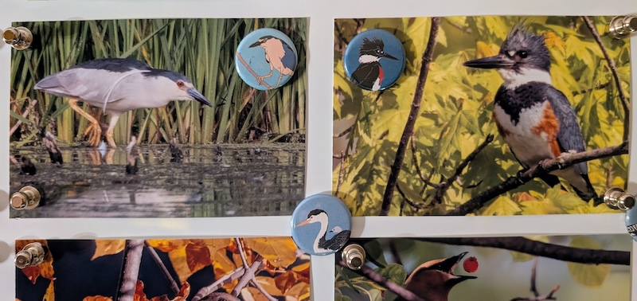
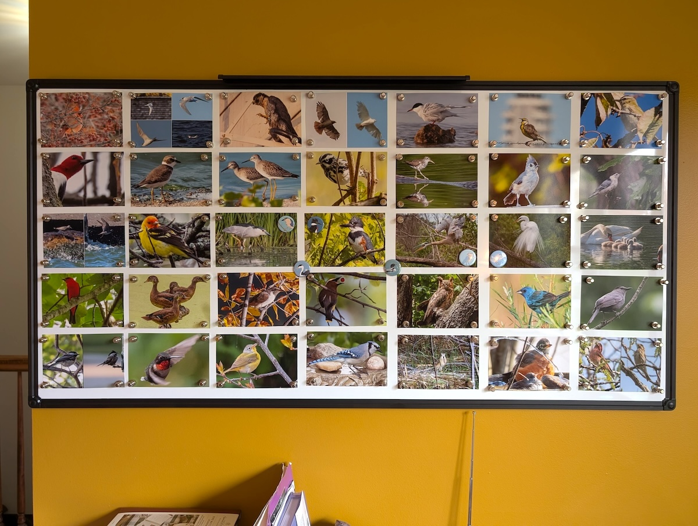
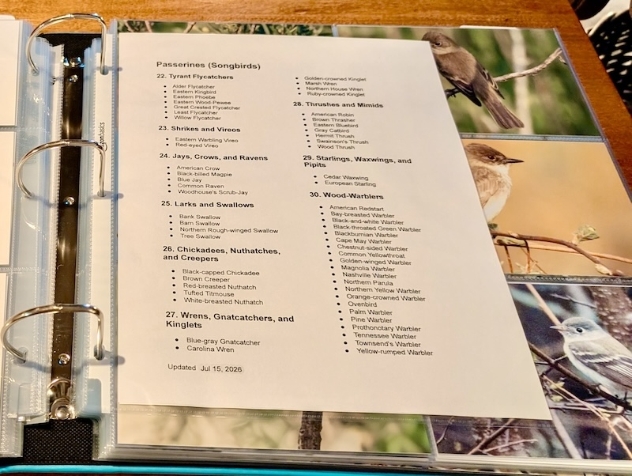
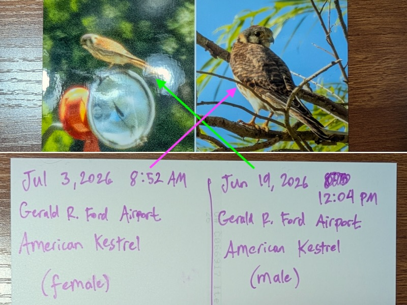
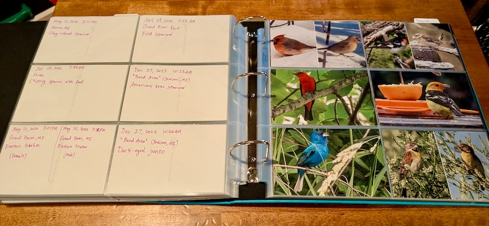
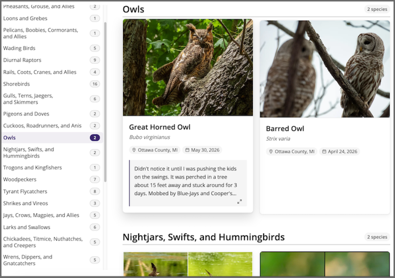
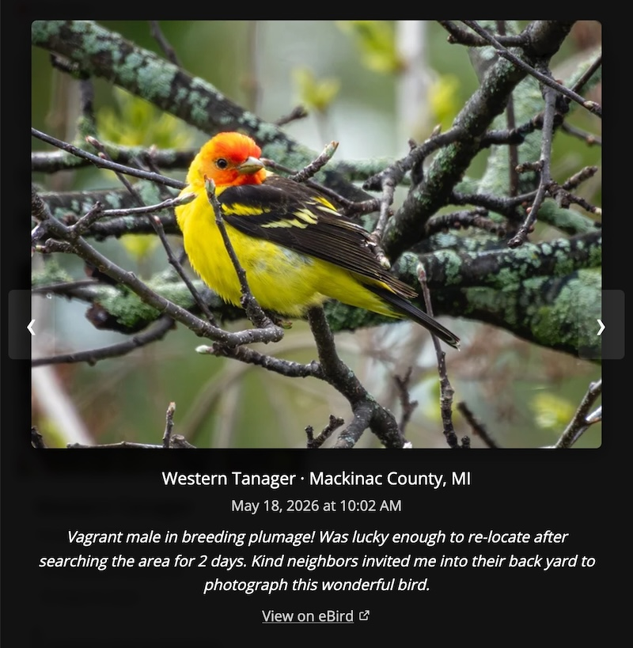
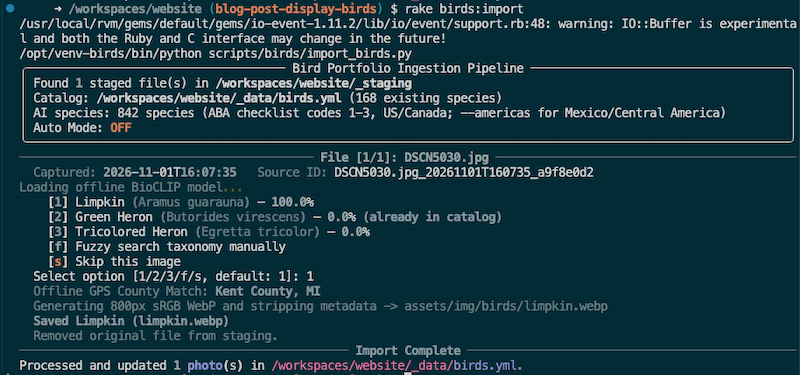

I like birds. I enjoy photographing birds even more. There's a challenge involved to understand how a species might move, where it's most visible, and what behaviors it may display. The resulting photos help me remember all of the fascinating species I've come across and the memories associated with each outing. 

Rather than tethering the photos to an album on my phone, I've produced three additional ways to enjoy my bird photos.

<!-- ## Table of Contents -->



## 1: Our Living Whiteboard

> Displaying _our_ favorite photos at any given time

I wanted a living space on my wall that I could easily change and rearrange on a whim with whatever bird photos brought me the most joy. 

My first thought was to use clips to hang photos on a string, but I was afraid that the photos would curl up over time. I briefly weighed some kind of cork board, but I didn't want to put holes through my photos.

My final consideration was to use a magnetic surface to hang photos. I found some really nice painted metal magnet boards online. They were attractive and thin, but were prohibitively expensive. I nixed that. 

Lucky for me, whiteboards are pretty similar and mass-produced, which makes them _cheap_. A decent-sized whiteboard would only set me back ~$55. So that's the route I went.

*My kid helping measure while we install the whiteboard on the wall*

For my setup, I went with a 48"x24" whiteboard. It would allow me to fit up to 35 4"x6" photos if arranged in a 7x5 grid.

Whenever I print my bird photos, I always choose giclée prints. Giclée is a specific type of print that uses pigment-based ink and archival-grade paper. Even the cheapest prints are _leagues_ better than what you'd get at a local 1-hour pharmacy store. Mine are usually ~$0.50 a print.

I make sure my prints use a semi-gloss surface finish (instead of glossy) as the light in our room isn't well controlled. It gives a pretty good balance between preserving details, fingerprint resistance, and minimizing the glare of reflections.

I pin all four corners of each photo with magnets so the edges don't curl when the humidity or temperature changes.

> A while back, I was gifted a few _special_ magnets with different bird species on them. I've been using those as a fun little game to find and photograph the species from each bird magnet. Only 2 to go!

*Black-crowned Night Heron (left) and female Belted Kingfisher (right) being held up by their matching magnets*

I'd like to take a moment to highlight a grand achievement. Every single photo on the whiteboard (currently) was taken in _Michigan_ **in 2026**. Including the vagrants! (Except for the Northern Cardinal in the top-left corner. That was from 2025.) What an incredible year for birding it has been!

*Our ever-changing whiteboard displaying our favorite bird photos*

My only regret is that I didn't buy an _even bigger_ whiteboard for _more_ bird photos to be displayed at the same time. I'd love to fill the entire wall!

---

## 2: Bird Photo Life List Binder

> Displaying _my_ best photos of each species

I maintain a Google Photos album that contains a single image for every bird species I have photographed. It's supposed to represent my best (and sometimes only) photo I've managed to capture of each species so far. 

Some photos include collages to showcase sexual dimorphism, seasonal plumage shifts, or different molts. It's a fun way to show off their differences.

In an effort to better enjoy the photos, every few months I print off some 4"x6"s of my newest species and recently improved photos. 

I organize them in a binder and split it into 4 major sections:

1. Waterbirds & Game Birds
2. Raptors, Rails & Shorebirds
3. Near-Passerines
4. Passerines (Songbirds)

*Index page for the current section of the bird photo life list binder*

Each major section is broken down into 1 of 34 different subsections. It closely follows the same ordering that my Sibley field guide uses.

Here's a markdown template file (with all headers and subsections) that anyone can use to create their own index pages.

<!-- If an HTML tag has an attribute markdown="block", then the content of the tag is parsed as block level elements. -->
<!-- https://kramdown.gettalong.org/syntax.html#html-blocks -->
<details markdown="block">

<summary>[Markdown] Example Index Template</summary>

```markdown
## **Waterbirds & Game Birds**

### **1\. Swans, Geese, and Ducks**

> * (No birds yet)

### **2\. Grouse, Quail, and Allies**

> * (No birds yet)

### **3\. Loons and Grebes**

> * (No birds yet)

### **4\. Flamingos**

> * (No birds yet)

### **5\. Tubenoses**

> * (No birds yet)

### **6\. Tropicbirds, Boobies, and Frigatebirds**

> * (No birds yet)

### **7\. Pelicans, Cormorants, and Anhingas**

> * (No birds yet)

### **8\. Wading Birds**

> * (No birds yet)

## <!-- Page Break -->

## **Raptors, Rails & Shorebirds**

### **9\. Diurnal Raptors**

> * (No birds yet)

### **10\. Rails, Gallinules, Coots, and Cranes**

> * (No birds yet)

### **11\. Shorebirds**

> * (No birds yet)

### **12\. Skuas, Jaegers, Alcids, Gulls, and Terns**

> * (No birds yet)

## <!-- Page Break -->

## **Near-Passerines**

### **13\. Pigeons and Doves**

> * (No birds yet)

### **14\. Cuckoos and Anis**

> * (No birds yet)

### **15\. Owls**

> * (No birds yet)

### **16\. Nightjars**

> * (No birds yet)

### **17\. Swifts and Hummingbirds**

> * (No birds yet)

### **18\. Trogons and Kingfishers**

> * (No birds yet)

### **19\. Woodpeckers**

> * (No birds yet)

### **20\. Falcons**

> * (No birds yet)

### **21\. Parrots**

> * (No birds yet)

## <!-- Page Break -->

## **Passerines (Songbirds)**

### **22\. Tyrant Flycatchers**

> * (No birds yet)

### **23\. Shrikes and Vireos**

> * (No birds yet)

### **24\. Jays, Crows, and Ravens**

> * (No birds yet)

### **25\. Larks and Swallows**

> * (No birds yet)

### **26\. Chickadees, Nuthatches, and Creepers**

> * (No birds yet)

### **27\. Wrens, Gnatcatchers, and Kinglets**

> * (No birds yet)

### **28\. Thrushes and Mimids**

> * (No birds yet)

### **29\. Starlings, Waxwings, and Pipits**

> * (No birds yet)

### **30\. Wood-Warblers**

> * (No birds yet)

### **31\. Sparrows and Allies**

> * (No birds yet)

### **32\. Cardinals, Tanagers, and Grosbeaks**

> * (No birds yet)

### **33\. Blackbirds, Meadowlarks, and Orioles**

> * (No birds yet)

### **34\. Finches and Old World Sparrows**

> * (No birds yet)
```
</details>

For the photos, I once again go with giclée prints. But since I know these will be viewed up close, I choose a glossy surface finish.

On the back of each photo, I write:

- Date & time (for understanding plumage or behavior)
- Rough location
- Species (sex/age/plumage if known)
- Additional comments from the memory

> I recently switched to using Sakura Microperm ultra-fine pens on the back of my photographs as they're chemically stable and shouldn't cause any damage to the photo in my lifetime. 

If it's a collage, I'll divide the back and write the same notes for each image component.

*A retired collage with handwritten notes of the American Kestrel. Notes line up with the correct side when you flip the photo over.*

I place each 4"x6" photo into a pocket of the 12"x12" binder insert. Each page displays 6 photos. I leave the backs unblocked so I can read the writing on the reverse. 

If I can't completely fill out a subsection on a page, I insert a 4"x6" photo printer blank (they're really cheap!). The filled pages are clipped into a larger 12"x12" scrapbook binder.

The result is a coffee table binder ready to be browsed by family or friends. 😃

*Example page of the bird photo life list binder*

---

## 3: Online Bird Photo Life List

> Displaying _my_ best photos of each species ... _online_

Not everyone has access to my bird scrapbook binder. I wanted another way that I could display my bird photo life list for people _not_ visiting my home. I decided to create an online photo collection.

- [kyleniewiada.org/birds/](/birds/)

*Screenshot of the bird photo life list webpage*

My online bird photo life list follows an organization nearly identical to my binder's. It is split into similar subsections, but also sorted by taxonomic sequence within each. 

Every bird photo is set in a card which displays the common/scientific names, location, date, and any additional (truncated) notes. 

The cards should be easy to browse on both desktop and mobile. There are search filters and navigational links that allow a user to immediately jump to a different subsection.

Interacting with the bird photo will open it in a gallery viewer where additional details are displayed.

*Gallery view showing details on the Western Tanager*

While in the gallery view, a user can navigate to the previous or next photos. When they exit the gallery, they will be brought to the card of the species they were just viewing.

### Importing New Photos

This website (currently) runs on Jekyll. That means all of the content is generated ahead of time and statically served to the user. Instead of manually updating the bird photos in my gallery, I use a pipeline to streamline the work.

Using Claude, I made a process to import and update the photos on my `/birds` page. By scripting the import process, I automate resizing a photo, stripping the metadata, looking up the taxonomy, and editing my website data index.

I have a Google Photos album that remains the source of truth for all of my bird life list photos. When I have new ones to add to my website, I download them from the Google Photos album and place them in a staging folder that gets processed using a single command.

```sh
rake birds:import
```

> This exact tooling is built for me. It makes assumptions about my folder layout, dev container, and taxonomy data. If you're curious how it works, the details can be found in the [bird import README](https://github.com/aav7fl/website/blob/main/scripts/birds/README.md) in my website's repo. Just don't expect it to work anywhere else without some changes.

For each photo, the script walks me through a few prompts:

1. Has this file already been imported? Each photo gets a fingerprint from its filename, capture time, and a hash of its contents. If the fingerprint matches a bird already on the page, it's skipped.
2. Which species is it? An offline AI model (BioCLIP) shows its top 3 guesses with a confidence score. I can accept one of the results, or search by name if it's wrong. The guesses are currently restricted to regular US and Canada birds from the ABA Checklist.
3. Where was it taken? The photo's GPS coordinates (before they're stripped out) are matched against US county boundaries using an offline lookup. Is GPS data missing from the photo? The script offers my recent counties to pick from instead.
4. Updating a species with a better photo? If I already have the species on my list, the script confirms before overwriting the old photo.

*Import script running on a recent photo I took of a Limpkin*

Once I've answered the prompts, the photo is converted into an 800px WebP. All metadata is stripped (GPS, camera, timestamps), and a copyright tag is written back in its place. Then the script records the species, date, and county in a data file that Jekyll uses to build the page. 

The species names, taxonomic order, and eBird species codes all come from eBird's taxonomy. This helps keep my page aligned with my eBird life list (like after a taxonomy update!), and it's what powers the "View on eBird" link in the gallery viewer.

> Note: The photos I submit to eBird receive minimal editing. The ones on my page (and in my binder) are for me, so they get more aggressive crops or edits (like unblurring).

The AI species detection in my pipeline isn't perfect, but it's pretty good at saving me the work of typing in a bunch of information! On my own catalog, the AI model correctly lists the species in its top 3 results about 90% of the time. I think it does very well because each of my bird life list photos is _supposed_ to be the best example I have taken of a species. 

The whole import process saves _so much time_. If I'm downloading my entire life list album, it helps me figure out which photos have already been imported and which ones are new. By auto-filling a lot of the information, all I need to do is double-check the output or help it fill in the blanks.

After I commit and merge the changes, the site deploys itself with the new bird photos.

## Conclusion

Not everyone is into photographing birds. Some do it just for documentation's sake. That's an angle I take as well sometimes, but it's fun to see the different behaviors that can be captured for a species. 

Being able to display and remember my favorite ones brings me joy. I hope these setups give others some ideas on different options to recollect the birds they've seen.
