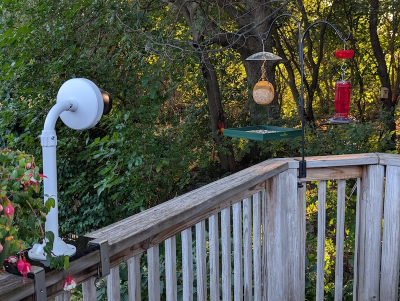
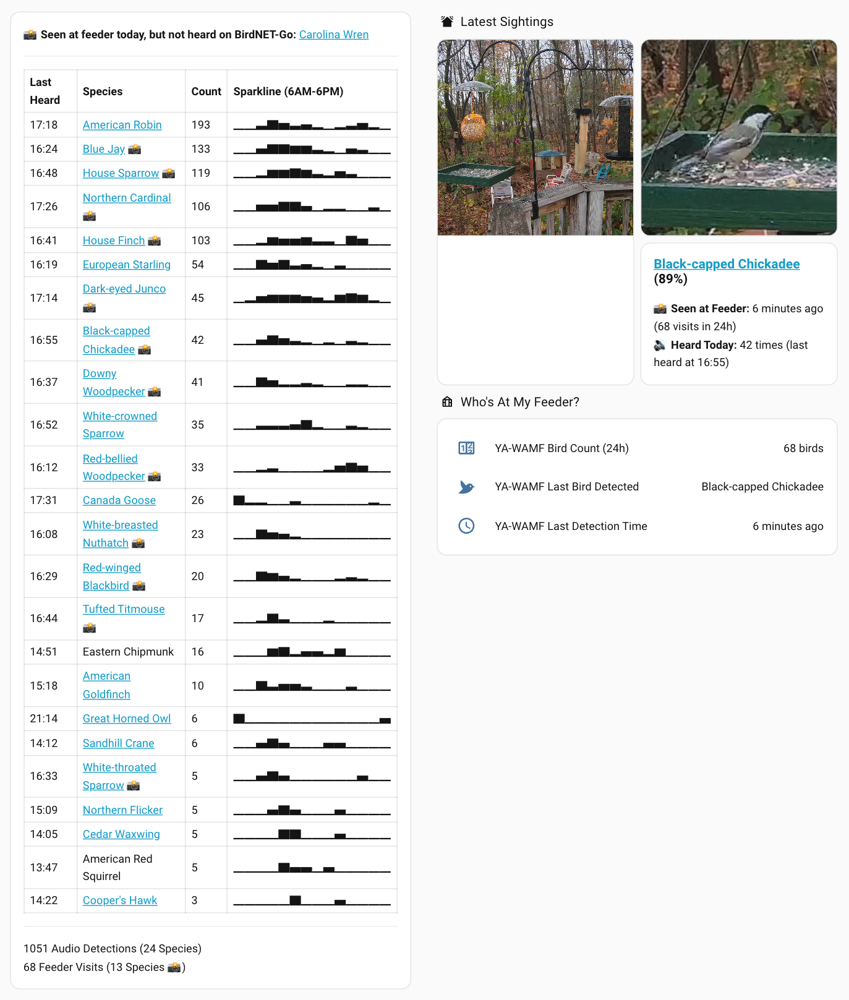
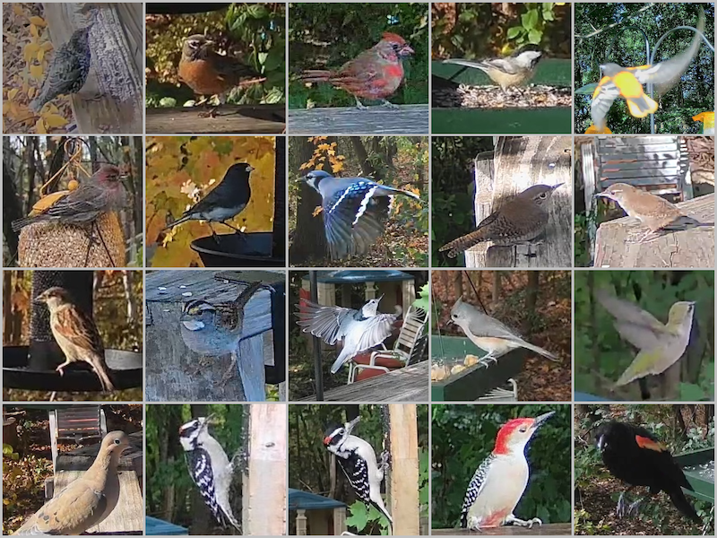
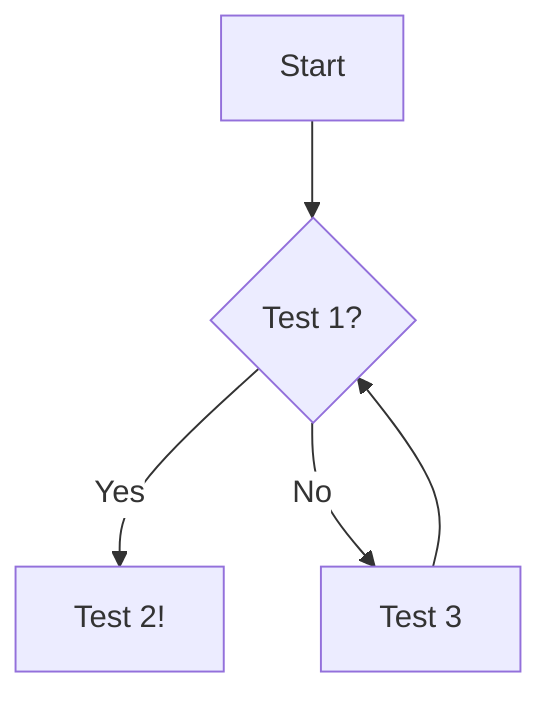

Lorem ipsum dolor sit amet consectetur adipiscing elit. Quisque faucibus ex sapien vitae pellentesque sem placerat. In id cursus mi pretium tellus duis convallis. Tempus leo eu aenean sed diam urna tempor. Pulvinar vivamus fringilla lacus nec metus bibendum egestas. Iaculis massa nisl malesuada lacinia integer nunc posuere. Ut hendrerit semper vel class aptent taciti sociosqu. Ad litora torquent per conubia nostra inceptos himenaeos.


<!-- ## Table of Contents -->



<!-- If an HTML tag has an attribute markdown="block", then the content of the tag is parsed as block level elements. -->
<!-- https://kramdown.gettalong.org/syntax.html#html-blocks -->
<details markdown="block">

<summary>Changelog</summary>

> - 2026-07-13: Changelog Entry #1
> - 2026-07-14: Changelog Entry #2
> - 2026-07-15: Changelog Entry #3

</details>

## TODO

- Add some kind of link with Home Assistant. Automations/camera/tracking? What does the API provide.

## Example Post

Lorem ipsum dolor sit amet consectetur adipiscing elit. Quisque faucibus ex sapien vitae pellentesque sem placerat. In id cursus mi pretium tellus duis convallis. Tempus leo eu aenean sed diam urna tempor. Pulvinar vivamus fringilla lacus nec metus bibendum egestas. Iaculis massa nisl malesuada lacinia integer nunc posuere. Ut hendrerit semper vel class aptent taciti sociosqu. Ad litora torquent per conubia nostra inceptos himenaeos.

## Callout

> Example callout

[This is a link](https://example.com)

## Image

*My security camera pointed directly at two of my bird feeders*

*Cross-confirmed detections and sightings between BirdNET-Go and Yet Another WhosAtMyFeeder (YA-WAMF)*

*Collage of bird species that my feeder camera has captured in the last few months*

## Remove Metadata

```bash
exiftool -all= -overwrite_original -r .

exiftool -gpslatitude .
```

## Line Numbers


exiftool -all= -overwrite_original -r .

exiftool -gpslatitude .


## Table

{: .table-post}
| Syntax      | Description | Test Text     |
| :---        |    :----:   |          ---: |
| Header      | Title       | Here's this   |
| Paragraph   | Text        | And more      |


## Mermaid Diagram



## Details

<!-- If an HTML tag has an attribute markdown="block", then the content of the tag is parsed as block level elements. -->
<!-- https://kramdown.gettalong.org/syntax.html#html-blocks -->
<details markdown="block">

<summary>[YAML] Example Configuration</summary>

```yaml

template:
  - trigger:
      - platform: time_pattern
        # Let's be honest, we don't need to check often. 
        # But 5 minutes should be reactive enough if I need to correct an event date.
        minutes: "/5" 

```
</details>


Combining **YetAnother-WhosAtMyFeeder (YA-WAMF)** with **BirdNET-Go** in Home Assistant bridges optical feeder detections with acoustic soundscape data. Below is the complete, self-contained reference for the sensors, automations, and dashboard cards we built.

---

## 1. YA-WAMF Daily Summary `command_line` Sensor & Push Trigger

While YA-WAMF's native Home Assistant integration only exposes the single most recent detection (`sensor.ya_wamf_last_bird_detected`), querying the YA-WAMF `/api/events` endpoint directly gives Home Assistant a complete daily species summary (`sensor.ya_wamf_daily_summary`) that stays 100% in sync with YA-WAMF's database—even if you delete or reclassify false positives in the YA-WAMF web UI.

### Prerequisite: Enable `Last Detection Event` in Home Assistant

To avoid hammering the YA-WAMF API with frequent polling, we use `sensor.ya_wamf_last_detection_event` as a push trigger to update the `command_line` sensor the instant a new bird visits the feeder (mirroring the BirdNET-Go MQTT push pattern).

* **Important Note:** The `Last Detection Event` sensor (`sensor.ya_wamf_last_detection_event`) is **disabled by default** in the YA-WAMF Home Assistant integration. To enable it, go to **Settings → Devices & services → YetAnother-WhosAtMyFeeder**, click on the device, locate **Last Detection Event** under the **Sensors** section (shown as disabled), click it, click the gear icon, toggle **Enabled** on, and click **Update**.


### Step 1A: `command_line.yaml` Sensor

This fetches the last `2000` events from your YA-WAMF instance (sized to comfortably cover heavy 1,600+ detection days), filters for events matching today's local date (`YYYY-MM-DD`), and aggregates them by species with visit counts and latest timestamps:

```yaml
# command_line.yaml
- sensor:
    name: "YA-WAMF Daily Summary"
    unique_id: "ya_wamf_daily_summary"
    command: >
      TODAY=$(date +%Y-%m-%d);
      curl --connect-timeout 5 --max-time 15 --retry 3 --retry-delay 0 --retry-max-time 20 -s
      "<FEEDER_URL>/api/events?limit=2000" |
      jq --arg today "$TODAY" '
        (if type == "array" then . else (.items // .events // []) end)
        | map(select((.detection_time // .start_time // "") | startswith($today)))
        | group_by(.display_name // .label // .species)
        | map({
            common_name: (.[0].display_name // .[0].label // .[0].species),
            count: length,
            latest_seen: (map(.detection_time // .start_time) | max)
          })
        | sort_by(-.count)
        | {species_list: .}
      '
    value_template: >
      
        {{ value_json.species_list | length }}
      
        0
      
    unit_of_measurement: "species"
    json_attributes:
      - species_list
    scan_interval: 300
    command_timeout: 35

```

(Note: Just like your `sensor.birdnet_*` entities, consider adding `sensor.ya_wamf_daily_summary` to your `recorder: exclude:` list in `configuration.yaml` if you want to keep large attribute payloads out of the Home Assistant history database.)

### Step 1B: Automation to Force Immediate Updates on Every Visit

Because `sensor.ya_wamf_last_bird_detected` doesn't change state when two birds of the same species visit back-to-back, this automation watches `sensor.ya_wamf_last_detection_event` (which updates its event ID on every single visit) and forces `sensor.ya_wamf_daily_summary` to refresh immediately:

```yaml
alias: Trigger YA-WAMF API fetch
description: Forces sensor.ya_wamf_daily_summary to update immediately when a bird lands
triggers:
  - trigger: state
    entity_id:
      - sensor.ya_wamf_last_detection_event
    not_to:
      - unknown
      - unavailable
conditions: []
actions:
  - action: homeassistant.update_entity
    target:
      entity_id: sensor.ya_wamf_daily_summary
mode: queued
max: 5

```

---

## 2. Card: "Feeder Visitor Dossier" (Live Snapshot + Acoustic Lookup)

**What it does:** This vertical stack pairs YA-WAMF's cropped live feeder snapshot (`camera.ya_wamf_latest_bird_snapshot`) with a stateless Markdown card. It takes the species name from `sensor.ya_wamf_last_bird_detected` and cross-references it against your existing `sensor.birdnet_daily_summary` and `sensor.birdnet_species_summary` sensors.

* It pulls the `species_code` from BirdNET-Go to make the bird's name a clickable eBird link.


* It displays the YA-WAMF confidence score, relative time since the feeder visit, and total 24h feeder visits.


* It reports whether the bird in the photo has been **Heard Today** on BirdNET-Go (with count and last-heard time), is a **Silent Visitor Today** (heard in the past, but silent today), or is a **Visual-Only Species** (never detected by BirdNET-Go).


```yaml
type: vertical-stack
cards:
  - type: picture-entity
    entity: camera.ya_wamf_latest_bird_snapshot
    name: Latest Feeder Visitor
    show_state: false
    show_name: false
    tap_action:
      action: more-info
  - type: markdown
    content: >-
      
      
      

      
      
      

      
        
        

        
        

        
        

        
        
        
        

        
          
          
          {%- set audio_line = '🔊 **Heard Today:** ' ~ b.count ~ ' times (last heard at ' ~ (heard_t | as_timestamp | timestamp_custom('%H:%M', true) if heard_t != none else b.latest_heard) ~ ')' -%}
        
          
          
        
          
        
      ### {{ title }} ({{ conf_pct }}%)

      📸 **Seen at Feeder:** {{ seen_str }} ({{ states(entity_count) }} visits in 24h)<br>{{ audio_line }}
      
      No recent feeder detections.
      

```

---

## 3. Card: Combined BirdNET-Go Daily Summary + YA-WAMF Feeder Badges & Silent Visitors

**What it does:** Upgrades your existing **Daily Species Summary With Sparklines** Markdown card by combining `sensor.birdnet_daily_summary` with `sensor.ya_wamf_daily_summary`:

* **Top Callout Banner:** At the very top of the card, it lists any species that were **🔇 Seen at Feeder, Not Heard Today** (with visit counts and last-seen times). If every feeder species today was also vocal on BirdNET-Go, it displays a `✅ All X feeder species seen today were also heard on BirdNET-Go.` confirmation banner instead.
* **Inline `📸` Badges:** In the main BirdNET-Go table, any species that also physically visited the feeder today gets a `📸` icon next to its name.


* **Dual-Sensor Footer:** At the bottom, it displays both total **Audio Detections** and total **Feeder Visits** for the day.

```yaml
type: markdown
content: >-
  
  
  
  
  
  
  
  
    
      
    
  
  
  **🔇 Seen at Feeder, Not Heard Today:**
  
  - {{ b.common_name }} ({{ b.count }} {{ 'visit' if b.count == 1 else 'visits' }}, last seen {{ as_datetime(b.latest_seen) | as_local | as_timestamp | timestamp_custom('%H:%M', true) if as_datetime(b.latest_seen) != none else b.latest_seen }})
  
  ---
  
  ✅ **All {{ feeder_data | count }} feeder species seen today were also heard on BirdNET-Go.**

  ---
  
  Last Heard | Species | Count | Sparkline (6AM-6PM)
  :-- | :-- | :-- | --
  
  {#- Basic Info -#}
  
  
  
  
  
  
  {#--- Sparkline Calculation (Full Day Aggregated - 14 slots) ---#}
  
   {#- Default value -#}
  
    {#- Aggregate counts: [0-6], 6..18, [18-24] (14 slots total, safe concatenation) -#}
    
    
    
    

    {# Check if list has expected count before finding max #}
    
      {#- Find Max for Scaling -#}
      

      {#- Define Sparkline Characters (7 levels, U+2581 to U+2587) -#}
      
      

      
        {#- Map value to character index (0-6), scale factor 7, max index 6 -#}
        
        {#- Append character -#}
        
      
      
    
      
    
  
  {#--- End Sparkline Calculation ---#}

  {#- Output Row -#}
  {{ today_at(time) | as_timestamp | timestamp_custom('%H:%M', true) }} | [{{ name }}]({{ ebird_url }}){{ name }}{{ badge }} | {{ count }} | {{ sparkline_str }}
  

  ---
  {{ species_data | sum(attribute='count') | int }} Audio Detections ({{ species_data | count }} Species)
  
  {{ feeder_data | sum(attribute='count') | int }} Feeder Visits ({{ feeder_data | count }} Species 📸)
  
  
  No bird species data available or list is empty.
  
  
  BirdNET-Go API is not available.
  

```

---

## 4. Conditional "Stealth Visitor" Pop-Up Card

**What it does:** Hides a dedicated photo + alert card completely unless the most recent bird at the feeder visited within the last 60 minutes AND has **0 audio detections** on BirdNET-Go today.

Because Home Assistant's frontend `conditional` card only evaluates entity states (not Jinja2 templates) and always forces itself visible while in Dashboard Edit Mode, this uses a lightweight template `binary_sensor` to drive the visibility cleanly.

### Step 4A: `template.yaml` Binary Sensor

```yaml
# template.yaml
- binary_sensor:
    - name: "YA-WAMF Stealth Visitor Active"
      unique_id: ya_wamf_stealth_visitor_active
      icon: mdi:volume-off
      state: >-
        
        
        
        
          
          {{ (now() - seen_dt).total_seconds() < 3600 and not heard_today }}
        
          false
        

```

### Step 4B: Dashboard `conditional` Card

*(Note: Exit Dashboard Edit Mode by clicking **Done** in the top right to see the card hide when `binary_sensor.ya_wamf_stealth_visitor_active` is `off`.)*

```yaml
type: conditional
conditions:
  - condition: state
    entity: binary_sensor.ya_wamf_stealth_visitor_active
    state: "on"
card:
  type: vertical-stack
  cards:
    - type: picture-entity
      entity: camera.ya_wamf_latest_bird_snapshot
      name: "🔇 Stealth Visitor (Seen, Not Heard Today)"
      show_state: false
      show_name: true
    - type: markdown
      content: >-
        
        
        
        
        
        🔇 **{{ seen_bird }}** was spotted at the feeder {{ relative_time(seen_dt) if seen_dt != none else '' }} ago, but has not been heard by BirdNET-Go today.
        
        *(Edit Mode Preview: **{{ seen_bird }}** was heard today, so this card is hidden in normal view.)*
        

```